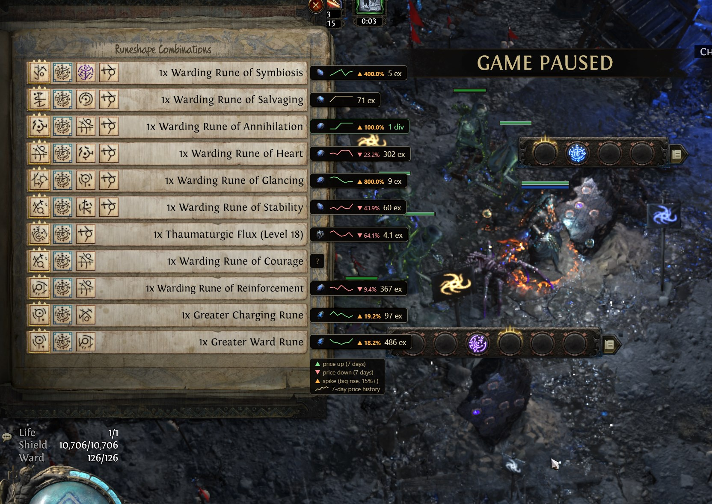
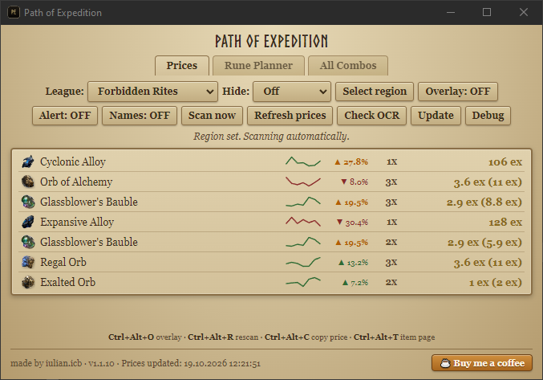
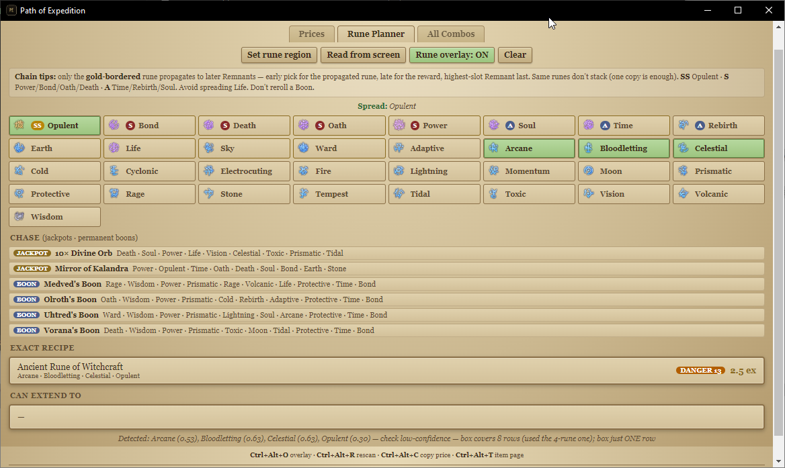
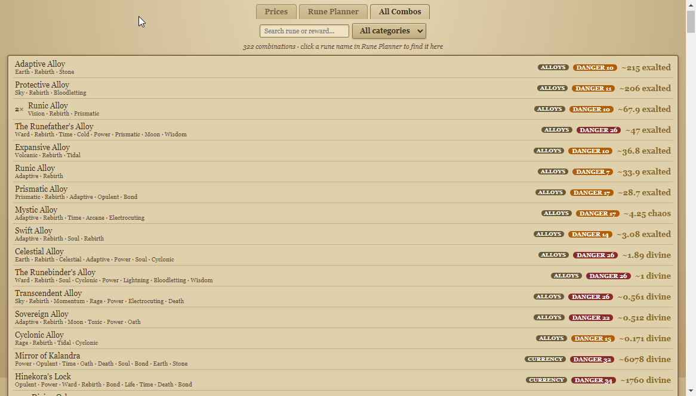
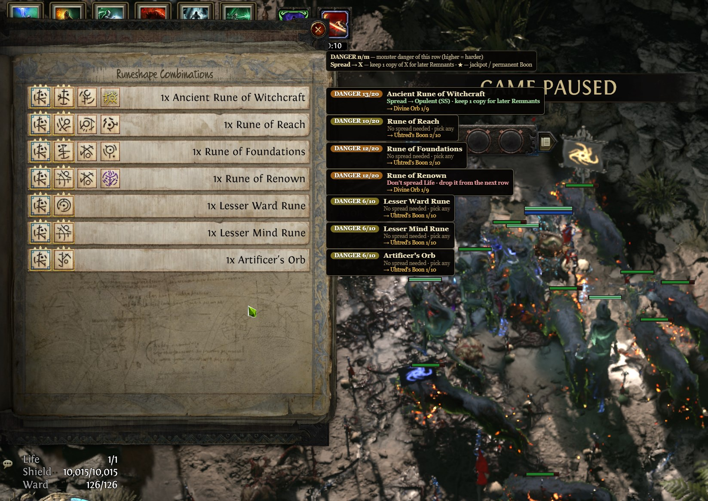

<div align="center">

# Path of Expedition

### Live Expedition loot pricing + Runeshape planner for **Path of Exile 2**

Price your Expedition drops while you run. Plan your Runeshape combos. Never alt-tab again.

[](https://github.com/iulicafarafrica/PathOfExpedition2/releases)
[](#quick-start)
[](LICENSE)
[](https://poe.ninja)



*Live poe.ninja prices drawn straight over your Runeshape panel.*

</div>

---

## What is this?

A small Windows app that **reads the Expedition reward panel from your screen** and tells you what those drops are worth, using live prices from poe.ninja. It shows them right over the game in a click-through overlay, or in a compact window.

It also ships with the full Runeshape rune database (**33 runes, 322 combinations**): a **Rune Planner** that does the combo math for you, and a second overlay that reads your runes and tells you what to keep and what to chase.

| Local & private | Zero input lag | Free & open source |
| :---: | :---: | :---: |
| OCR runs on your PC, nothing is uploaded | Click-through overlay, the game keeps your mouse | MIT licensed, read it or build it yourself |

<div align="center">



*Prefer a normal window? Same price list, with icons, value tiers and a running total.*

</div>

> [!NOTE]
> This project is **not affiliated with, endorsed by, or sponsored by Grinding Gear Games** or poe.ninja. "Path of Exile" and "Path of Exile 2" belong to Grinding Gear Games. It is a fan-made tool, and GGG's ToS apply to everything you do in-game. Prices come from poe.ninja's public exchange API, the same one their website uses.

---

## Quick start

1. **Download** the latest build from [Releases](https://github.com/iulicafarafrica/PathOfExpedition2/releases). Same app, two flavors:

 | File | Best for |
 | --- | --- |
 | `Path of Expedition <version>.exe` | **Portable.** No install, run from anywhere, delete whenever. |
 | `Path of Expedition Setup <version>.exe` | **Installer.** Start-menu entry, normal uninstall. |

2. **Launch it** and pick your **league** from the dropdown.
3. In-game, open the **Runeshape Combinations** panel.
4. Click **Select region**, drag the green box over the reward list, press **Enter**.
5. Done. It scans every 3 seconds and shows the running total as items land. Hit **Overlay** to draw prices over the game.

Your region and league are saved. If you move the game window, re-select the region.

> [!TIP]
> Want to check the file first? Scan it on [VirusTotal](https://www.virustotal.com/gui/file-analysis/ZDdjNmU3ZDU1YWIxYWQ0NDI1Mjc4NGFlMmU5MDJlNjY6MTc5MjI1ODY3NQ==) or build it yourself. See [Open source & security](#open-source--security).

---

## Features

### Pricing

| | |
| --- | --- |
| **Live poe.ninja prices** | Currency, Runes, Expedition, Verisium and Uncut Gems, normalized per 1 Divine and shown in your league's currency (exalted on HC, divine on softcore). |
| **Stack totals** | `5x` shows the whole stack, with the unit price in parentheses. |
| **Value tiers** | **gold** = 10+ Divine, **green** = 1+ Divine. Everything else stays readable. |
| **Price trend** | ▲ green / ▼ red arrow for the last 7 days, so you know if it's a good time to sell. |
| **Market movers** | Items up 15%+ over 7 days get highlighted. |
| **Auto currency** | Cheap items in exalted, expensive in divine, same rounding as the poe.ninja site. |
| **Item icons & links** | Real item icons on every row. Click a row to open its poe.ninja page (volume, history). |
| **Hide filter** | Hide drops below Off / ≥0.01 / ≥0.1 / ≥1 / ≥10 Divine to keep busy runs clean. |
| **Sound alert** | A chime when an item worth **1 Divine+** drops, once per new item. Toggle with **Alert**. |

### In-game experience

| | |
| --- | --- |
| **Price overlay** | Prices aligned with each reward row, in a transparent click-through window. Toggle with **Overlay**. |
| **Rune overlay** | A second overlay beside the rune panel that auto-detects runes per row. See [Rune overlay](#rune-overlay). |
| **Screenshots & recording** | The overlay is capturable: Snipping Tool, Print Screen, OBS. |
| **League switch** | Change league in-app and the current panel is re-priced instantly. |

### Smart reading

| | |
| --- | --- |
| **Windows OCR** | Uses the OCR built into Windows. No cloud, no model downloads. See [How the OCR works](#how-the-ocr-works). |
| **Smart name matching** | Layered: exact → digit fixes (`0→o`, `1→l`) → prefix → fuzzy. Fixes possessives ("Jeweller s" → "Jewellers") and won't guess levels on uncut gems. |
| **Noise filter** | Chat lines and panel noise without an `Nx` quantity get dropped. |
| **Multi-monitor & DPI** | Binds capture to the right display. 125% / 150% scaling is fine. |

### Reliability

| | |
| --- | --- |
| **Offline cache** | If poe.ninja or your network is down, it keeps running on the last snapshot (marked "cached, offline") and recovers on its own. |
| **Auto-refresh** | Prices reload every 30 min. **Refresh prices** forces it. |
| **Update check** | Checks GitHub Releases on launch and every 30 min. **Update now** downloads and launches it, SHA-256 verified. |
| **Check OCR & Debug window** | Verify the OCR engine and see the raw OCR lines and app log when something reads wrong. |

---

## Price overlay

Turn **Overlay** on and prices are drawn over the game, lined up with each reward row. It's a transparent, **click-through** window: the game keeps all your mouse input and the overlay adds no lag. Each bar is only as wide as its text, with a near-opaque background so it's readable over any scene.

- Requires **borderless windowed** mode. True exclusive fullscreen hides any overlay.
- While the overlay is on, the app window's list is hidden. Turn it off and the list comes back.
- The overlay sits just to the **right** of your selected region, so leave some free space there.

---

## Rune Planner

The app bundles an offline database of **all 33 runes** (tier, monster danger, spread behavior) and **all 322 Runeshape combinations**.

<div align="center">



*Pick your runes and see the exact recipe, what it can extend to, spread advice and the jackpots to chase.*

</div>

**Rune Planner tab.** Pick the runes you're looking at (click the chips, or **Read from screen** to detect them automatically):

| Section | What you get |
| --- | --- |
| **Exact recipe** | What your current runes produce right now, with live prices, a **DANGER** badge and a **BOON** badge on permanent-boon combos. |
| **Can extend to** | Every bigger combination your runes can still grow into. |
| **Spread advice** | Only gold-bordered runes propagate to later Remnants. It tells you which to carry forward (*Spread: Power, Opulent*) and which to avoid (*Don't carry forward: Life*). |
| **Chase** | Jackpots and boons worth going for (**Mirror of Kalandra, 10× Divine Orb, the four Boons**), with a live check on whether you're already **on track**. |

**All Combos tab.** The full 322-combination database, searchable by rune or reward, with filters:

`Alloys (14)` · `Currency (93)` · `Gems (61)` · `Runes (131)` · `Uniques (23)`

Click a rune name in the planner to jump straight to its combinations.

<div align="center">



*All 322 combinations with category, danger level and live price.*

</div>

---

## Rune overlay

Box the rune panel once with **Set rune region**, then turn the overlay on. It's a separate click-through window (run it alongside the price overlay, on its own, or not at all) that sits right of the panel and **auto-detects the runes in each row** every couple of seconds, using image template matching. No OCR, no typing.

<div align="center">



*The rune overlay next to the Runeshape panel: danger, reward, spread advice and chase progress for every row.*

</div>

For every row it shows:

- **DANGER n/m**: the row's monster danger out of its maximum
- **Reward**: or an honest *"N possible results"* when ambiguous, with **★** on jackpots and permanent boons
- **Spread note**: *"Spread → Oath (S) · keep 1 copy for later Remnants"*, *"Don't spread Life · drop it from the next row"*
- **Chase progress**: a gold line like *"→ Mirror of Kalandra 3/9"*

Like the price overlay, it needs **borderless windowed** mode and free space to the right of the region. A short legend shows for the first 20 seconds, and your region and on/off state are remembered.

---

## Troubleshooting

| Problem | Fix |
| --- | --- |
| **Garbled text / nothing matches** | Wrong or missing OCR language, see [below](#how-the-ocr-works). The **Debug window** shows exactly what OCR read. |
| **Some drops missing** | Make the region cover the whole list, keep chat and other windows off the panel, and keep in-game UI scale normal. |
| **Overlay doesn't show** | Use **borderless windowed** (exclusive fullscreen hides overlays) and leave free space right of the region. |
| **Wrong price** | poe.ninja has no data for that item, or it's a level-specific uncut gem (deliberately not guessed). Prices are always current exchange value. |
| **Rate-limited by poe.ninja** | The app respects their ~5 min cache and refreshes at most every 30 min. Spamming **Refresh** will hit their limits. |
| **Multi-monitor** | Select the region on the monitor where the panel actually is. |
| **Rune overlay empty / wrong runes** | Re-box with **Set rune region**, stay in borderless windowed, and keep tooltips and chat off the rune icons. |

---

## How the OCR works

<details>
<summary><b>Click to expand</b></summary>

<br>

No Tesseract, no Python, no downloaded model. The app uses **Windows' own OCR engine** (`Windows.Media.Ocr`), the same one behind "Copy text from image" in Windows Photos.

Per scan:

1. **Capture**: Electron's `desktopCapturer` grabs the screen at native resolution, crops your region (DPI-corrected) and writes a temp PNG.
2. **Recognize**: a bundled PowerShell script (`ocr.ps1`) loads the PNG and runs `OcrEngine.RecognizeAsync`. It tries **English** first, then falls back to your Windows profile languages. It returns each line's text and position as JSON.
3. **Parse**: the main process groups lines into reward rows (name + `Nx`), filters noise and matches against the price cache.

Everything runs locally. No screenshot or text ever leaves your machine.

**Requirement:** an OCR language pack must be installed in Windows:

> Settings → Time & Language → Language & region → (your language) → Language options → **Download** under "Optional features" (OCR)

If items don't match, hit **Check OCR** in the app. It reports whether the engine loads and which languages are available.

</details>

---

## Open source & security

The whole app is in this repo, [MIT licensed](LICENSE), with no hidden part. The `.exe` in Releases is exactly this source built with electron-builder.

**Network access (full list, verifiable in `main.js`):**

| Endpoint | Why |
| --- | --- |
| `poe.ninja` exchange API | Prices (same endpoint their site uses) |
| `web.poecdn.com` | Item icons |
| `api.github.com` | Release feed for the update check |
| Release `.exe` URL | **Only** when you press "Update now" |
| `buymeacoffee.com` | **Only** when you click the footer link |

No telemetry, no analytics, no other endpoints. Settings live in one `config.json` under `%APPDATA%\path-of-expedition`.

**Build it yourself** (Windows, Node 18+):

```bash
git clone https://github.com/iulicafarafrica/PathOfExpedition2
cd PathOfExpedition2
npm install
npm run dist
```

Executables land in `dist/`. `package-lock.json` pins dependencies, so a fresh clone builds the same thing.

**VirusTotal (current build):** [view scan](https://www.virustotal.com/gui/file-analysis/ZDdjNmU3ZDU1YWIxYWQ0NDI1Mjc4NGFlMmU5MDJlNjY6MTc5MjI1ODY3NQ==). New releases get a new hash, so feel free to re-scan.

<details>
<summary><b>"My antivirus flagged it" — what's going on?</b></summary>

<br>

It happens. A single engine (so far McAfee) reports a name like `Ti!89ED4493BBF4`. That is **not a known virus**: it's the first 12 characters of the file's own SHA-256, which is how McAfee labels *generic heuristic* detections, as opposed to real malware signatures (which carry a family name like `W32.Sality` or `Trojan:Win32/...`).

What triggers the heuristic here:

- the exe is **unsigned** (no code-signing certificate yet)
- the portable build is a self-extracting archive with a bundled Electron runtime
- it spawns a local PowerShell process for OCR, captures a screen region and draws an always-on-top overlay

Signs of a false positive: 1-2 of ~70 engines flagging it, the full source is public, and it contacts no endpoint beyond the list above. If a new scan looks different from that pattern, please open an issue, and hold off running the file until it's checked.

Code signing for releases is in progress and will remove most of these flags.

</details>

---

## Tech

<details>
<summary><b>Click to expand</b></summary>

<br>

- **Electron**: Node.js main process (capture, OCR, prices, overlay, IPC), `contextIsolation` + sandboxed renderer, no remote code, navigation locked down
- **electron-builder**: portable `.exe` and NSIS installer (x64)
- **Vanilla HTML/CSS/JS** UI: three screens (main window, price overlay, rune overlay), no framework
- **Rune detection**: pure image template matching (33 bundled rune sprites), no OCR
- **Bundled database**: `data/runes.json` (33 runes) + `data/recipes.json` (322 combinations, patch 0.5.5), loaded once, fully offline
- **WinRT OCR via PowerShell**: `Windows.Media.Ocr`, `Windows.Graphics.Imaging`
- **Web Audio API** for the alert chime, generated in code
- **poe.ninja** exchange API (`/poe2/api/economy/exchange/current/overview`) and image CDN
- **GitHub Releases API** for updates (SHA-256 verified)

Dev: `npm run dev` runs it unpackaged, `npm run dist` builds both executables into `dist/`.

</details>

---

## Feedback & support

Got an idea, a bug or a feature request? [Open an issue](https://github.com/iulicafarafrica/PathOfExpedition2/issues).

If it saves you a headache (or a few exalted), a coffee is appreciated:

[](https://buymeacoffee.com/iulian.icb)
