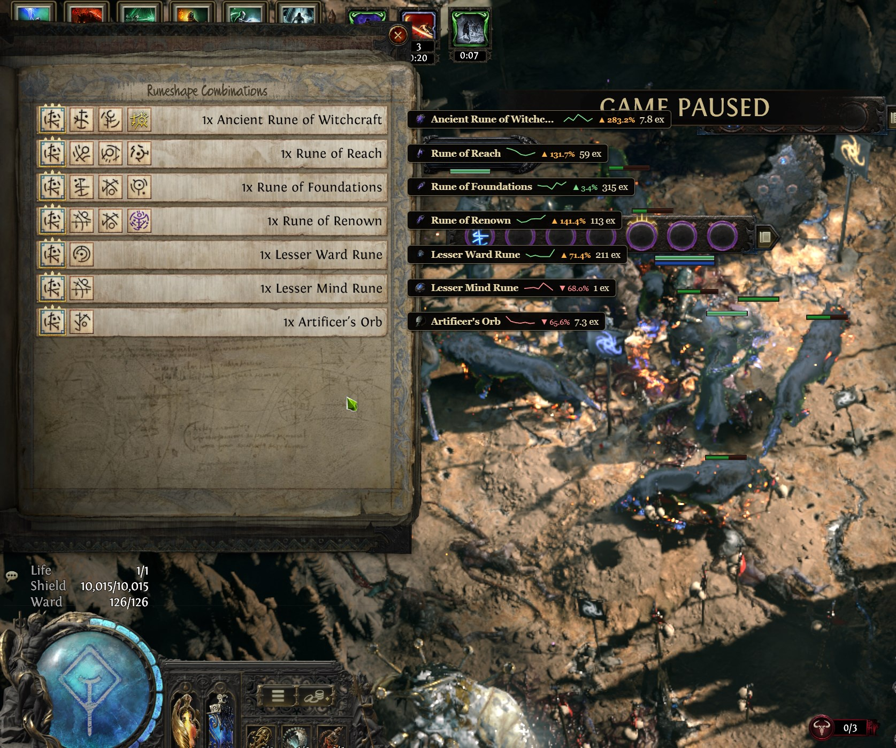
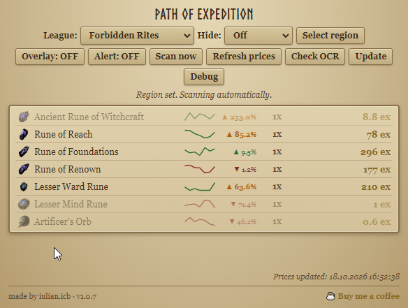

# Path of Expedition



*The in-game overlay: live poe.ninja prices drawn straight over your Runeshape panel.*

A small Windows desktop app for Path of Exile 2. It reads the Expedition reward panel from your screen and tells you what those drops are actually worth, using live prices from poe.ninja — right over the game, in a click-through in-game overlay, or in a compact window. It also ships with the full Runeshape rune database (all 33 runes, all 322 combinations): a **Rune Planner** that does the combo math for you, and a second in-game overlay that reads the runes themselves and tells you what to keep and what to chase.



*Prefer a normal window? The same price list, with icons, value tiers and the running total.*

**This project is not affiliated with, endorsed by, or sponsored by Grinding Gear Games.** "Path of Exile", "Path of Exile 2", and related marks belong to Grinding Gear Games. This tool is a fan-made convenience; GGG's ToS apply to everything you do in-game. It is also not affiliated with poe.ninja — the app just uses their public exchange API for prices, same as their own website does.

---

## Quick start

1. Grab the latest version from [Releases](https://github.com/iulicafarafrica/PathOfExpedition2/releases). There are two files, same app, different delivery:
   - **`Path of Expedition <version>.exe`** — portable: no install, run it from anywhere (desktop, USB stick) and delete it whenever.
   - **`Path of Expedition Setup <version>.exe`** — classic Windows installer: puts it in your Programs folder, creates a Start-menu entry, and can be uninstalled normally.

   If you'd like, run it through [VirusTotal](https://www.virustotal.com/gui/file-analysis/ZDdjNmU3ZDU1YWIxYWQ0NDI1Mjc4NGFlMmU5MDJlNjY6MTc5MjI1ODY3NQ==) first — this is the current build, and the project is fully open source so you can also just read the code or build it yourself (see [Open source & security](#open-source--security)).
2. Run it and pick your **league** from the dropdown.
3. In-game, open the **Runeshape Combinations** panel.
4. Click **Select region**, drag the green box over the reward panel and resize it to cover the list, then press **Enter**.
5. That's it. It scans the panel every 3 seconds and shows the running total as items land. Hit **Overlay** to draw the prices straight over the game (see [In-game overlay](#in-game-overlay)).

Your region and league are saved, so the next time you launch it just picks up where you left off. If you move the game window, re-select the region.

## Features

| Feature | What it does |
| --- | --- |
| Rune Planner | A tab that does the Runeshape math for you. Pick the runes you're holding (or **Read from screen** to detect them automatically) and it shows the **exact recipe** (with live price and a monster-DANGER badge), every combo that combination **can extend to**, and **spread advice** — which rune is worth carrying a copy of into later Remnants and which to drop. See [Rune Planner](#rune-planner--all-combos). |
| All Combos | Browse the entire built-in database of **322 Runeshape combinations** — search by rune or reward, filter by category (Alloys, Currency, Gems, Runes, Uniques). See [Rune Planner](#rune-planner--all-combos). |
| In-game rune overlay | A second, separate click-through overlay that sits beside the Runeshape rune panel and **auto-detects the runes in each row** (no typing, no OCR). For every row it shows the DANGER level, the reward, what to spread, and how close that row gets you to a jackpot. See [In-game rune overlay](#in-game-rune-overlay). |
| In-game overlay | Prices are drawn over the game, aligned with each item row — no alt-tabbing. It's a transparent, **click-through** window: the game keeps all your mouse input and there's **no added lag**, and it only covers as much screen as the text needs. Toggle with **Overlay**. |
| Sound alert | A short chime plays when a new item worth **1 Divine or more** appears. Toggle with **Alert** — it's remembered between sessions and rings only once per new item. |
| Region capture | You frame the part of the screen that matters (the reward list). It works on multi-monitor setups and handles DPI scaling, so 125%/150% displays are fine. |
| Windows OCR | Reads the panel text using the OCR built into Windows itself — no cloud, no extra engine, no model downloads. See [How the OCR works](#how-the-ocr-works). |
| Smart name matching | OCR isn't perfect, so matching is layered: exact → digit fixes (`0→o`, `1→l`, …) → prefix → fuzzy edit-distance. It also fixes possessives ("Jeweller s" → "Jewellers") and refuses to guess levels on uncut gems. |
| Live poe.ninja prices | Pulls the exchange overview for Currency, Runes, Expedition, Verisium and UncutGems, normalizes everything to "per 1 Divine", and converts it to the league's primary currency correctly (exalted on HC, divine on softcore). |
| Item icons | Each row shows the real item icon (served from poe.ninja's image CDN), so the list is easy to scan at a glance. |
| Item page link | Click a row and its poe.ninja item page opens in your browser (volume, price history) — same league as selected. |
| Auto currency | Cheap items show in exalted, expensive ones in divine — same rounding rules as the poe.ninja site, so numbers match what you'd see there. |
| Stack totals | Prices are shown for the whole stack (`5x` = 5 × unit), with the unit price in parentheses when qty > 1. |
| Price trend | A little ▲ (green) / ▼ (red) arrow next to the name shows whether the item went up or down over the last 7 days (poe.ninja data), so you know if now's the time to sell. |
| Value tiers | Rows are highlighted by value — **gold** for 10+ Divine, **green** for 1+ Divine. Everything else stays fully readable (nothing is greyed out). Easy to spot what mattered. |
| Market movers | Items rising sharply over the last 7 days (15%+) are highlighted, so you can see what's worth selling right now. |
| Hide filter | Pick a minimum value (Off / ≥0.01 / ≥0.1 / ≥1 / ≥10 Divine) to hide cheap drops from both the overlay and the list — keeps the screen clean during a busy run. |
| League switch | Change league in-app; prices reload and the current panel is re-priced immediately. |
| Auto-scan | Scans every 3 s once a region is set. No start/stop button to forget. |
| Price auto-refresh | Prices reload every 30 minutes (poe.ninja caches ~5 min anyway); **Refresh prices** forces it on demand. |
| Offline cache | If poe.ninja or your network is down, the app keeps working off the last price snapshot (marked "cached — offline") and recovers automatically as soon as the site answers again. |
| Chat/noise filter | Chat lines and panel noise that isn't a priced item and has no explicit `Nx` quantity get dropped, so the list stays clean. |
| Update check | Checks GitHub Releases on launch and every 30 min. When a newer release is out, a banner appears and **Update now** downloads and launches it (SHA-256 verified). |
| Check OCR | Verifies that the Windows OCR engine is present and which languages are installed. Useful when the text looks garbled. |
| Debug window | Shows the raw OCR lines and an app log for the last scans — the first place to look when something reads wrong. |
| Screenshot & recording | The overlay is capturable, so you can screenshot or record your run with Snipping Tool, Print Screen or OBS. |
| Version in footer | The footer shows the app version, so you always know which build you're running. |
| Buy me a coffee | If it saves you money or sanity, a coffee is appreciated: https://buymeacoffee.com/iulian.icb |

## In-game overlay

Turn the overlay **on** and the prices are drawn straight over the game, lined up with each row of the reward panel — no alt-tabbing, no second monitor needed. It is a transparent, **click-through** window: the game keeps all of your mouse input and the overlay adds no input lag. Each bar is only as wide as its text, so it covers as little of the game as possible, and the background is nearly opaque so it stays readable over any scene.

Notes:

- Requires **borderless windowed** mode — a true exclusive-fullscreen mode hides any overlay.
- While the overlay is on, the app window's list is hidden (everything shows in-game instead). Turn the overlay off and the list comes back in the window.
- You can screenshot and record the overlay normally (Snipping Tool, Print Screen, OBS).
- The overlay sits just to the **right** of the region you selected, so pick a region with a bit of free space to its right.

## Rune Planner & All Combos

The app bundles a complete, offline database of **all 33 runes** (tier, monster danger, spread behavior) and **all 322 Runeshape combinations**, so the decision-making can be done for you:

- **Rune Planner tab** — pick the runes you're looking at (click the chips, or press **Read from screen** and the app detects them from the panel automatically). You get:
  - **Exact recipe** — what your current runes produce right now, with live poe.ninja prices, a **DANGER** badge (monster danger of the combo) and a **BOON** badge on permanent-boon combos;
  - **Can extend to** — every bigger combination your runes can still grow into, so you know what to keep chasing;
  - **Spread advice** — only gold-bordered runes propagate to later Remnants, and not all of them are worth it. The planner tells you which of your runes to carry a copy of forward (*Spread: Power, Opulent*) and which to avoid (*Don't carry forward: Life*);
  - **Chase** — the jackpots and permanent boons worth going for (**Mirror of Kalandra, 10× Divine Orb, the four Boons**), with a live check on whether your current runes are already **on track** for any of them.
- **All Combos tab** — the entire 322-combination database, searchable by rune name or reward, with category filters: **Alloys (14) · Currency (93) · Gems (61) · Runes (131) · Uniques (23)**. Click a rune name in the planner to jump straight to its combinations.

## In-game rune overlay

Toggle it from the Rune Planner tab: box the rune panel once with **Set rune region**, then turn the overlay on. It's a separate, transparent, **click-through** window (independent from the price overlay — run both, either one, or neither) that sits to the right of the panel and, every couple of seconds, **auto-detects the runes in each row** using image template matching — no OCR, no typing. For every row it shows:

- a **DANGER n/m** badge — the row's monster-danger sum out of the row's maximum (higher = harder monsters);
- the **reward** — or an honest *"N possible results"* when the combination is ambiguous — with a **★** on jackpots and permanent boons;
- a one-line **spread** note (*"Spread → Oath (S) · keep 1 copy for later Remnants"*, *"Don't spread Life · drop it from the next row"*);
- **chase progress** — a gold line like *"→ Mirror of Kalandra 3/9"* when the row's runes count toward a jackpot or boon.

Notes:

- Like the price overlay, it needs **borderless windowed** mode and leaves free space to the right of the region.
- A short orientation legend appears at the top for the first 20 seconds after you switch it on, then hides itself.
- The region and on/off state are remembered and restored on launch.

## How the OCR works

There is no Tesseract, no Python, no neural model downloaded on first run. The app uses **Windows' own OCR engine** — the `Windows.Media.Ocr` WinRT API, the same one behind "Copy text from image" in Windows Photos and the clipboard OCR.

Per scan, the pipeline is:

1. **Capture** — Electron's `desktopCapturer` grabs the full screen at native resolution, the saved region is cropped out (with DPI scaling applied), and the crop is written to a temp PNG.
2. **Recognize** — a small bundled PowerShell script (`ocr.ps1`) loads the PNG through the WinRT imaging stack and runs `OcrEngine.RecognizeAsync`. The engine is created for **English** first (item names are English), falling back to your Windows profile languages if the English OCR pack isn't installed. It returns each line's text plus its x/y position, as JSON.
3. **Parse** — the main process groups lines into reward rows (name + `Nx` quantity), filters out noise, and matches them against the price cache.

Everything runs locally on your machine; no screenshot or text ever leaves it.

**Requirement:** an OCR language pack must be installed in Windows. For the English UI, make sure English OCR is on:

> Settings → Time & Language → Language & region → (your language) → Language options → **Download** under "Optional features" (OCR).

If in-game text comes out garbled or items don't match, hit **Check OCR** in the app — it tells you whether the engine loads and which languages are available. If it says the engine is unavailable, install the language pack and restart the app.

## Tech

- **Electron** — main process in Node.js (capture, OCR, prices, overlay, IPC), `contextIsolation` + sandboxed renderer, no remote code, navigation locked down.
- **electron-builder** — ships as a portable `.exe` and an NSIS installer (x64).
- **Vanilla HTML/CSS/JS** for the UI — three screens (main window, price overlay, rune overlay), no framework, no build step for the renderer.
- **Rune detection** — the rune overlay recognizes runes with pure **image template matching** (33 bundled rune sprites compared against the captured panel), so it needs no OCR at all.
- **Bundled rune database** — `data/runes.json` (33 runes) + `data/recipes.json` (322 combinations, patch 0.5.5), loaded once at startup; the planner runs fully offline.
- **WinRT OCR via PowerShell** (`System.Runtime.WindowsRuntime` → `Windows.Media.Ocr`, `Windows.Graphics.Imaging`) — Windows-native recognition, no external OCR dependency.
- **Web Audio API** for the alert chime — generated in code, no sound files.
- **poe.ninja exchange API** (`/poe2/api/economy/exchange/current/overview`) — same data their website displays; results normalized to per-1-Divine internally.
- **poe.ninja image CDN** — item icons.
- **GitHub Releases API** — update detection and download (with SHA-256 verification).

Dev notes: `npm run dev` runs it unpackaged, `npm run dist` builds both executables into `dist/`.

## Open source & security

The whole app is in this repository, [MIT licensed](LICENSE), and there is no hidden or "proprietary" part. The `.exe` in the releases is exactly this source built with electron-builder — nothing is injected after the fact.

**What it talks to over the network** (full list, verifiable in `main.js`):

- `poe.ninja` exchange API — prices (the same endpoint their website uses)
- `web.poecdn.com` — item icons
- `api.github.com` — this repo's release feed, for the update check
- the release's `.exe` download URL — **only** when you press "Update now"
- buymeacoffee.com — **only** when you click the footer link

That's it. No telemetry, no analytics, no other endpoints. Screenshots and OCR text are processed locally and never uploaded anywhere. Your settings live in a single `config.json` under your Windows user data folder (`%APPDATA%\path-of-expedition`).

**Build it yourself** (Windows, Node 18+):

```
git clone https://github.com/iulicafarafrica/PathOfExpedition2
cd PathOfExpedition2
npm install
npm run dist
```

The executables land in `dist/`. `package-lock.json` pins the dependencies, so a fresh clone builds the same thing.

**VirusTotal scan of the current build:** <https://www.virustotal.com/gui/file-analysis/ZDdjNmU3ZDU1YWIxYWQ0NDI1Mjc4NGFlMmU5MDJlNjY6MTc5MjI1ODY3NQ==>. (New releases get a new hash — feel free to re-scan before running.)

**"Wait, my antivirus flagged it?"** — that happens, and it's worth understanding. A single engine (so far: McAfee) reports a detection like `Ti!89ED4493BBF4`. That name is **not a known virus** — it's the first 12 characters of the file's own SHA-256, which is how McAfee labels its *generic behavioral* (heuristic) detections, as opposed to a signature for real malware (which would carry a family name like `W32.Sality` or `Trojan:Win32/...`). What feeds the heuristic in this case: the exe is **unsigned** (no code-signing certificate yet), the portable build is a self-extracting archive with a bundled Electron runtime, and the app spawns a local PowerShell process for Windows OCR, captures a screen region and draws an always-on-top overlay — exactly the behaviors those engines like to watch. The tells that it's a false positive: 1-2 of ~70 engines flagging it, the code above is the entire app (read it or build it yourself), and it talks to no network endpoint beyond the ones listed. If your AV or a new VirusTotal scan shows something different from that pattern, please open an issue — and consider holding off on running the file until it's looked at. I'm working toward code-signing the releases, which removes most of these flags at the source.

## Troubleshooting

- **Garbled text / nothing matches** → wrong or missing OCR language (see above). The Debug window shows exactly what OCR read.
- **Some drops missing** → make sure the region covers the whole list, the panel isn't covered by chat or another window, and in-game UI scale is normal.
- **Overlay doesn't show** → the game must be in **borderless windowed** mode; exclusive fullscreen hides overlays. Also leave some free space to the right of the region, since that's where the overlay is drawn.
- **Wrong price** → poe.ninja has no data for that item, or it's a level-specific uncut gem (the app deliberately won't guess). Prices are always the current exchange value, not a fixed "base".
- **Rate-limited by poe.ninja** → the app respects their ~5 min cache and refreshes at most every 30 min; if you spam Refresh, you'll hit their limits.
- **Multi-monitor** → select the region on the monitor where the panel actually is; the app binds the capture to that display.
- **Rune overlay shows nothing / wrong runes** → re-box the region with **Set rune region** (the whole panel or a single row), keep the game in borderless windowed, and make sure the rune icons aren't covered by tooltips or chat. The "no rows detected" hint only appears for a few seconds on purpose.

## Support

If this saves you a headache (or a few exalted), consider a coffee:

☕ **https://buymeacoffee.com/iulian.icb**

Issues and ideas: [GitHub issues](https://github.com/iulicafarafrica/PathOfExpedition2/issues).
